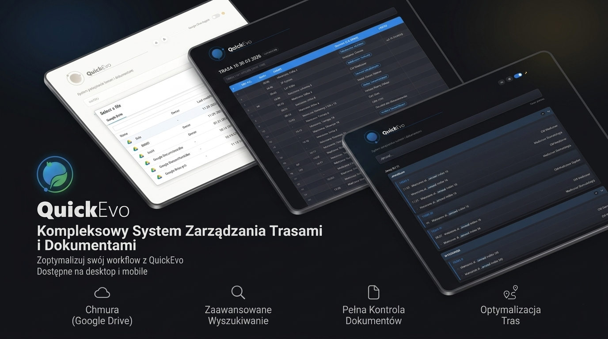

<p align="center">
  <picture>
    
  </picture>
</p>

# QuickEvo

  

 
 
 
 


Przeglądarkowe narzędzie do synchronizacji, wyszukiwania i podglądu tras z plików Excel (.xlsx, .xls) oraz CSV, z obsługą grafiku kierowców i Google Drive jako jedynego źródła danych.

***

## Krótki opis

QuickEvo to aplikacja webowa działająca w całości po stronie klienta w przeglądarce. Przetwarzanie plików, budowa indeksu wyszukiwania i przechowywanie danych odbywają się lokalnie z wykorzystaniem IndexedDB. Integracja z Google Drive umożliwia ręczną synchronizację dokumentów (trasy + grafik + kontakty + rejestracje) bezpośrednio z chmury i stanowi jedyny wspierany kanał dostarczania plików.

***

## Architektura

- **Client-Side Only** — cała logika biznesowa działa w przeglądarce użytkownika bez użycia własnego backendu.
- **Modułowa struktura JS** — warstwowy podział w katalogu `js/` (`entry`, `app`, `core`, `services`, `ui`, `storage`, `features`, `config`, `devtools`) oraz stopniowa modularyzacja logiki aplikacji.
- **Modułowy CSS** — główny plik `css/style.css` wykorzystuje dyrektywy `@import` do ładowania wyspecjalizowanych arkuszy stylów z katalogu `css/styles/` (`variables`, `base`, `header`, `search`, `results`, `preview`, `drivers`, `schedule`, `modals`, `diff`) oraz stylów `css/matrix.css`.
- **ESM (bez bundlera)** — logika aplikacji jest ładowana jako natywne moduły JavaScript (`<script type="module">`); biblioteka SheetJS/XLSX jest importowana bezpośrednio jako moduł ESM z CDN `https://esm.sh/`.
- **Shadow DOM** — debugger (`js/devtools/qe-debugger.js`) korzysta z izolowanego Shadow DOM, co zapobiega konfliktom stylów z głównym interfejsem.
- **Jednolita ścieżka synchronizacji Drive** — moduł `js/app/drive-unified-sync-application.js` odpowiada za kompletną obsługę wykrywania zmian, podglądu różnic i pobierania plików z Google Drive.
- **Lokalna persystencja** — silnik bazy IndexedDB (`quickevo_docs_v2`, wersja 2) gwarantuje szybki dostęp do zaimportowanych dokumentów i możliwość pracy bez stałego połączenia z siecią.

***

## Stan modułowy kodu (js/entry/app.js)

Główny plik wejściowy aplikacji (`js/entry/app.js`) pełni rolę kontenera orkiestracji i inicjalizacji serwisów.

- **Początkowy stan przed refaktoryzacją:** ~2331 linii
- **Obecny stan kodu:** **5067 linii** (obejmuje wsparcie dla zaawansowanych funkcji widoku Grafiku, Kierowców, podglądu diffu XLSX i modali synchronizacji)
- **Kierunek rozwoju:** Dalsza dekompozycja i wydzielanie zintegrowanych handlerów UI z `app.js` do wyspecjalizowanych modułów w `js/ui/` oraz `js/app/`.

***

## Funkcjonalności

### Wyszukiwanie i predykcja

- **Wyszukiwanie rozmyte (fuzzy matching):** Wykorzystanie algorytmu odległości Levenshteina do tolerowania literówek w zapytaniach.
- **Predykcyjne podpowiedzi inline (ghost text):** Sugestie tekstowe w czasie rzeczywistym podczas wpisywania z możliwością szybkiego uzupełnienia klawiaturą (Tab, Enter, Strzałka w prawo) oraz wskaźnikiem wielokrotnych dopasowań `↑↓`.
- **Indeksacja Trie w tle:** Wyszukiwanie prefiksowe wspierane przez moduł `PredictiveTrieIndex` oraz dedykowany Web Worker (`predictive-index-worker.js`), co zapobiega blokowaniu wątku głównego interfejsu.
- **Ranking i recencja:** Inteligentny ranking uwzględniający kolejność ważności (adresy → obiekty → trasy), recencję importu oraz historię akceptacji sugestii przechowywaną w `localStorage`.
- **Grupowanie i sortowanie wyników:** Prezentacja wyników pogrupowanych według plików źródłowych z opcją sortowania alfanumerycznego (A‑Z) lub wg najbliższej nadchodzącej godziny (⏱).
- **Kafelki i kody specjalne:** Przejrzysta prezentacja wyników w postaci zwijanych sekcji (STANDARD, WIECZOREK, SOBOTA, NIEDZIELA), czytelne wyróżnienie punktów "na telefon" oraz automatyczna detekcja obiektów laboratoryjnych (`KEY_LAB_TOKEN_SETS`).
- **Kontekst kierowcy w trasie:** Wyświetlanie kierowcy przypisanego do trasy na dany dzień w podglądzie pliku na podstawie grafiku i wybranej daty ISO (`YYYY-MM-DD`).

### Synchronizacja danych z Google Drive

- **Jednolite źródło danych:** Google Drive jako wspierany kanał dostarczania tras, grafików miesięcznych, kontaktów kierowców oraz rejestracji pojazdów.
- **Obsługa plików i ograniczenia:** Pobieranie i parsowanie plików `.xlsx`, `.xls` oraz `.csv` o rozmiarze do **5MB na plik**.
- **Unified Sync Modal:** Wspólny interfejs synchronizacji prezentujący dodane, zmodyfikowane i usunięte pliki na Google Drive przed zapisaniem ich w lokalnej bazie.
- **Wielowątkowość i kontrola narzutu:** Asynchroniczne pobieranie i przetwarzanie plików z ograniczoną współbieżnością (`runWithConcurrency`), dopasowujące liczbę równoległych połączeń do możliwości sprzętowych użytkownika (`hardwareConcurrency`).
- **Automatyczne odświeżanie danych:** Bezszwowe, natychmiastowe przeładowanie indeksów i widoków w miejscu po pomyślnym zakończeniu synchronizacji.
- **Podgląd różnic (XLSX Diff):** Wbudowany, lekki modal podglądu różnic (`Side by side` oraz `Lista`) pozwalający przeanalizować zmienione komórki arkusza przed ich zaakceptowaniem.
- **Wykrywanie usunięć:** Detekcja plików skasowanych na Google Drive z opcją ich bezpiecznego usunięcia z lokalnej bazy IndexedDB po potwierdzeniu przez użytkownika.

### Interfejs użytkownika i responsywność

- **Nawigacja sekcyjna:** Przełącznik głównych widoków (`TRASY` / `KIEROWCY` / `GRAFIK`) w formie dwustanowego toggle (ponowne kliknięcie aktywnej zakładki wraca do ekranu wyszukiwania).
- **Mobilna nawigacja dolna (Mobile Bottom App Bar):** Dedykowany dolny pasek dla urządzeń mobilnych z dużymi celami dotykowymi (54px), czytelnymi ikonami SVG oraz wizualnym wskaźnikiem aktywnej zakładki.
- **Wyłączenie auto-focusa na mobile:** Zapobieganie niechcianemu wysuwaniu się klawiatury ekranowej przy przełączaniu widoków na małych ekranach.
- **Widok KIEROWCY:** Kafelkowy układ reprezentacji kierowców ze podziałem na sekcje ról specjalnych (`Szef`, `Kierownik`, `Koordynator`, `Dyspozytor`) oraz główną listę alfabetyczną. Prezentuje dzisiejsze kody i trasy, przypisany numer rejestracyjny pojazdu z historii grafiku oraz numery kontaktowe.
- **Widok GRAFIK:** Nowoczesny data-grid do przeglądania harmonogramu miesiąca:
  - Przyklejony nagłówek dni i pierwsza kolumna z nazwiskami (sticky positioning).
  - Pasek nawigacji dniowej z przyciskami przełączania i automatycznym przechodzeniem między przełomami miesięcy.
  - Filtrowanie po kierowcy oraz nazwie/symbolu trasy.
  - Tryb pełnoekranowy (Full-Screen) zoptymalizowany pod przenieśne stanowiska i małe wyświetlacze.
  - Wyraźne oznaczenie weekendów oraz markerów specjalnych (`Z`, `UŻ`, `Dk`, `*D`, `*P`).
- **Dostosowanie motywu:** Ciemny motyw (domyślny) oraz jasny motyw z pamięcią preferencji użytkownika i płynnymi przejściami wizualnymi.

***

## Struktura projektu

```
QuickEvo/
├── assets/
│   └── hero.png           # Grafika do README
├── index.html           # Główny dokument HTML aplikacji
├── css/
│   ├── matrix.css       # Dedykowane style motywu Matrix
│   ├── style.css        # Główny punkt wejścia stylów CSS (dyrektywy @import)
│   └── styles/          # Modułowe arkusze stylów
│       ├── base.css       # Style bazowe, typografia i reset
│       ├── diff.css       # Style modala podglądu różnic XLSX
│       ├── drivers.css    # Style dla widoku Kierowców
│       ├── header.css     # Style nagłówka i paska nawigacyjnego
│       ├── modals.css     # Style okien modalnych i overlayów
│       ├── preview.css    # Style widoku podglądu trasy
│       ├── results.css    # Style dla kafelków i listy wyników
│       ├── schedule.css   # Style dla interaktywnej tabeli grafiku
│       ├── search.css     # Style paska wyszukiwania i podpowiedzi ghost
│       └── variables.css  # Zmienne CSS (kolory, motywy, spacing)
├── js/
│   ├── entry/           # Entrypointy ładowane w index.html
│   │   ├── app.js       # Główny bootstrap i orkiestracja aplikacji
│   │   └── dev-flags.js # Warunkowe ładowanie narzędzi deweloperskich
│   ├── app/             # Warstwa aplikacyjna (przypadki użycia)
│   │   ├── drive-unified-sync-application.js
│   │   ├── loading-application.js
│   │   ├── navigation-application.js
│   │   ├── preview-application.js
│   │   └── search-application.js
│   ├── config/          # Konfiguracja i stałe globalne
│   │   ├── constants.js
│   │   └── route-codes.js
│   ├── core/            # Czysta logika biznesowa i pomocnicza
│   │   ├── formatters/
│   │   │   ├── file-name.js
│   │   │   ├── highlight.js
│   │   │   ├── route-categories.js
│   │   │   ├── route-name.js
│   │   │   └── title-case.js
│   │   ├── data-store.js
│   │   ├── dom-refs.js
│   │   ├── excel-processor.js
│   │   ├── focus-visibility.js
│   │   ├── search-engine.js
│   │   ├── simple-xlsx-diff.js
│   │   ├── state.js
│   │   └── utils.js
│   ├── features/        # Moduły funkcjonalności (wyszukiwanie, sortowanie)
│   │   └── search/
│   │       ├── predictive-index-worker.js
│   │       ├── predictive-trie-index.js
│   │       ├── search-orchestrator.js
│   │       └── search-results-sort.js
│   ├── services/        # Usługi i integracje domenowe
│   │   ├── drive-service.js
│   │   ├── driver-contacts-service.js
│   │   ├── driver-registrations-service.js
│   │   ├── navigation-service.js
│   │   └── schedule-service.js
│   ├── storage/         # Persystencja danych lokalnych
│   │   └── docs-db.js
│   ├── ui/              # Moduły prezentacji i kontrolery DOM
│   │   ├── ui-components.js
│   │   ├── schedule-controller.js
│   │   ├── drive/
│   │   │   ├── drive-changes-modal.js
│   │   │   └── xlsx-diff-modal.js
│   │   ├── import/
|   │   │   └── import-summary-renderer.js
│   │   ├── loading/
│   │   │   ├── loading-overlay-dom.js
│   │   │   ├── loading-progress-controller.js
│   │   │   ├── loading-title.js
│   │   │   ├── logo-renderer.js
│   │   │   ├── welcome-loading-overlay-controller.js
│   │   │   └── welcome-progress-renderer.js
│   │   ├── logo/
|   │   │   └── quickevo-logo.js
│   │   ├── preview/
│   │   │   ├── modal-controller.js
│   │   │   ├── preview-controller.js
│   │   │   └── preview-labs-highlight.js
│   │   ├── results/
│   │   │   ├── results-category-controller.js
│   │   │   ├── results-dom.js
│   │   │   └── results-renderer.js
│   │   ├── search/
│   │   │   └── predictive-ghost.js
│   │   └── theme/
│   │       └── MatrixThemeToggle.js
│   ├── devtools/        # Panel narzędzi diagnostycznych
│   │   └── qe-debugger.js
│   └── tests/           # Testy automatyczne i regresyjne
│       └── tests.js
└── README.md
```

***

## Schema IndexedDB

**Baza danych:** `quickevo_docs_v2`  
**Wersja:** `2`  
**Magazyn obiektów:** `files` (`keyPath: 'name'`)

| Pole | Typ | Opis |
| --- | --- | --- |
| `name` | String | Nazwa pliku w bazie lokalnej (klucz główny) |
| `blob` | Blob | Surowa zawartość binarna dokumentu Excel/CSV |
| `size` | Number | Rozmiar pliku w bajtach |
| `updatedAt` | Number | Timestamp ostatniego zapisu lokalnego (ms) |
| `driveModifiedAt` | Number | Timestamp ostatniej modyfikacji w Google Drive (ms) |
| `routeCategory` | String | Kategoria trasy wyznaczona z folderu Drive (`STANDARD`, `WIECZOREK`, itp.) |
| `topLevelFolderName` | String | Nazwa folderu nadrzędnego pierwszego poziomu w Google Drive |

***

## Debugger i diagnostyka

Dedykowany moduł deweloperski `js/devtools/qe-debugger.js` udostępnia:

- **Panel Shadow DOM:** Pływający widget po prawej stronie (dostępny na desktopie dla viewportów >= 769px).
- **Przycisk ekranu powitalnego:** Możliwość szybkiego wymuszenia/ukrywania welcome screena w celach testowych.
- **Narzędzia czyszczenia pamięci:** Przycisk `clear db` (kasowanie IndexedDB) oraz `clear rnd` (losowa symulacja utraty ~20% plików).
- **Logowanie i benchmarking:** Funkcje `window.logAction(...)` oraz obiekt `window.QE_Debugger` do profilowania operacji.
- **Testy jednostkowe:** Automatyczne wykonanie zestawu testów przy uruchomieniu aplikacji z parametrem URL `?test=1` lub `?test=true`.

***

## Bezpieczeństwo i standardy

- **Content Security Policy (CSP):** Rygorystyczna nagłówkowa polityka CSP ograniczająca wykonywanie skryptów oraz połączenia sieciowe wyłącznie do zdefiniowanych źródeł (Google Drive/OAuth APIs, `'self'`, `blob:`, `data:`).
- **Ładowanie modułów ESM:** Brak konieczności stosowania zewn. procesów budowania (bundlerów). SheetJS ładowany w bezpiecznym modelu ESM.
- **Dostępność i Semantyka HTML:** Wykorzystanie standardowych elementów semantycznych, atrybutów ARIA, zachowanie odpowiedniej kolejności nawigacji klawiaturową oraz pełna obsługa reguły `prefers-reduced-motion`.

***

## Optymalizacje wydajności

- **Współbieżność Drive Sync:** Równoległy import plików z limitem ustawianym dynamicznie na podstawie liczby rdzeni wygenerowanej przez `navigator.hardwareConcurrency` oraz natury plików (do 8 dla tras, do 4 dla pomocniczych).
- **Porcjowanie renderowania:** Użycie `requestAnimationFrame` przy generowaniu długich list i kafelków, zapobiegające zamrażaniu interfejsu.
- **Event Delegation:** Zoptymalizowana obsługa zdarzeń na poziomach kontenerów nadrzędnych.
- **Lazy Rendering:** Generowanie podglądu diffu XLSX wyłącznie na żądanie po otwarciu modala.
- **Czystość pamięci RAM:** Automatyczne zwalnianie indeksów oraz pamięci podręcznej LRU przy usuwaniu dokumentów.
